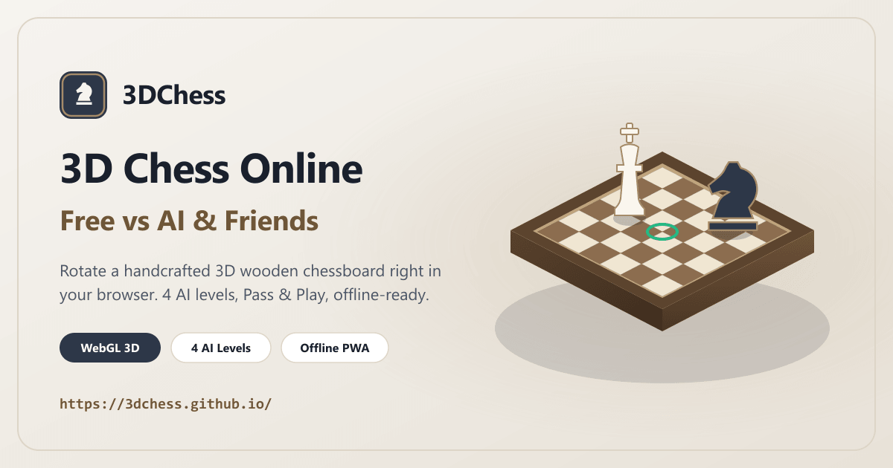

<div align="center">
  <a href="https://3dchess.github.io/">
    
  </a>

  <h1>3DChess</h1>

  <p>
    <strong>Studio-Crafted 3D Chess in Your Browser — Free vs AI &amp; Friends, 100% Client-Side &amp; Offline-Ready</strong>
  </p>

  <p>
    <a href="https://3dchess.github.io/">
      
    </a>
    <a href="https://kisharadilshan.gumroad.com/coffee">
      
    </a>
  </p>

  <p>
    <a href="https://github.com/3dchess/3dchess.github.io/actions/workflows/deploy.yml">
      
    </a>
    
    
    
    
    
    <a href="./LICENSE">
      
    </a>
  </p>

  <br />

  <a href="https://3dchess.github.io/">
    
  </a>
</div>

---

## Table of Contents

- [Overview](#overview)
- [Key Features](#key-features)
- [Controls & Keyboard Shortcuts](#controls--keyboard-shortcuts)
- [AI Engine Architecture](#ai-engine-architecture)
- [Tech Stack & Architecture](#tech-stack--architecture)
- [Project Structure](#project-structure)
- [Internationalization (8 Languages)](#internationalization-8-languages)
- [Design System & Accessibility](#design-system--accessibility)
- [Local Development](#local-development)
- [Deployment (GitHub Pages)](#deployment-github-pages)
- [Technical SEO & Performance](#technical-seo--performance)
- [Support & Freelance Inquiries](#support--freelance-inquiries)
- [License](#license)

---

## Overview

**3DChess** is an ultra-minimalist, zero-backend 3D chess web application built with **Astro 5**, **React 19**, **Three.js**, and **`chess.js`**. Every 3D Staunton chess piece is procedurally sculpted in code (`LatheGeometry` + `ExtrudeGeometry`) with zero external `.glb` model downloads—delivering instant startup, smooth 60fps animations, private client-side execution, and complete offline playability as an installable Progressive Web App (PWA).

No accounts. No trackers blocking gameplay. No servers required.

---

## Key Features

### Procedural Three.js WebGL Craftsmanship
- **Sculpted 3D Staunton Pieces**: Hand-tuned procedural geometries for **Pawn**, **Rook** (crenellated turret), **Knight** (beveled contoured horse head + mane), **Bishop** (collared mitre), **Queen** (8-pearl coronet crown), and **King** (imperial cross finial) in warm satin ivory and deep walnut/ebony finishes.
- **Tactile Wooden & Dark Slate Board**: Procedural in-memory wood-grain textures, beveled outer plinth, brass inlay trim, soft `2048×2048` PCF directional shadows, and readable algebraic coordinates (`a–h`, `1–8`) on all four rails.
- **Smooth GPU Animations**: Parabolic ease-out lift-and-glide piece travel (with higher knight arcs), simultaneous castling rook glides, and smooth capture fade-outs.

### Gameplay, Modes & Full Screen
- **vs AI (4 Difficulty Levels)**: Play as White or Black against an off-thread Web Worker engine (**Easy**, **Medium**, **Hard**, **Expert**).
- **2-Player Pass & Play**: Turn any laptop, tablet, or smartphone into a shared 3D wooden chessboard for local matches.
- **100% FIDE-Legal Rules**: Powered by `chess.js` with full support for kingside/queenside castling, en passant, accessible Pawn Promotion modal, check glow, checkmate, stalemate, threefold repetition, and insufficient-material draws.
- **Full Screen Play Mode**: One-tap edge-to-edge fullscreen using the native Fullscreen API with an automatic `100dvh` viewport fallback for iOS Safari and embedded views.
- **Hints, Undo & Procedural Web Audio**: On-demand best-move hint highlights, smart undo, and synthesized studio wood-tap / capture / castling / check SFX via the Web Audio API (zero audio file fetches).

### Offline-First PWA & Zero-JS Static Shell
- **Add to Home Screen**: Includes `manifest.webmanifest`, crisp PNG/SVG icons, native `beforeinstallprompt` integration, an iOS Safari installation popover, and a cache-first Service Worker (`public/sw.js`) covering all static bundles and the AI Web Worker.
- **Astro Islands Architecture**: Static HTML shell ships **0 KB** of framework JavaScript on content routes (`/how-to-play/`, `/hire-me/`) and hydrates only the interactive 3D chessboard island on Home (`client:load`).

---

## Controls & Keyboard Shortcuts

### Mouse & Touch

| Action | Desktop | Mobile / Tablet |
| :--- | :--- | :--- |
| **Orbit / Rotate Board** | Left-click & drag | One-finger swipe |
| **Zoom In / Out** | Mouse scroll wheel / trackpad pinch | Two-finger pinch |
| **Select & Move Piece** | Click piece → click highlighted square | Tap piece → tap highlighted square |
| **Keyboard Move Input** | Type UCI (`e2e4`, `e7e8q`) or SAN (`Nf3`, `O-O`) + `Enter` | Tap move input → type move → **Move** |

### Keyboard Shortcuts

| Shortcut | Action |
| :--- | :--- |
| `1` | Switch camera to **White POV** |
| `2` | Switch camera to **Black POV** |
| `3` | Switch camera to **Top-Down** overhead view |
| `4` | Switch camera to **Side** showcase angle |
| `F` | Toggle **Full Screen** play mode |
| `H` | Highlight AI **Move Hint** |
| `Ctrl+Z` / `⌘+Z` | **Undo** last move |
| `Esc` | Clear selection / close dialog / exit viewport Full Screen |

---

## AI Engine Architecture

All search and evaluation logic executes inside a dedicated ES Web Worker (`src/workers/chessAI.worker.ts`) so 3D camera orbiting and piece animations remain locked at **60fps**.

| Level | Search Depth | Key Techniques | Playstyle |
| :--- | :---: | :--- | :--- |
| **Easy** | 1 ply | Material + PST evaluation with controlled top-move noise | Relaxed & beginner-friendly |
| **Medium** | 2 plies | Alpha-Beta Negamax + Piece-Square Tables + MVV-LVA ordering | Balanced casual club match |
| **Hard** | 3 plies | Alpha-Beta + **Quiescence Search** + MVV-LVA + Bishop Pair bonus | Sharp tactical challenge |
| **Expert** | Iterative up to 4 plies | Iterative Deepening (`1450ms` budget) + Quiescence + Midgame/Endgame King PST phase interpolation | Strong positional & endgame play |

---

## Tech Stack & Architecture

| Layer | Technology | Role |
| :--- | :--- | :--- |
| **Framework** | Astro 5 (`output: 'static'`) | Static site generation, Islands Architecture, zero-JS subpages |
| **UI Island** | React 19 + TypeScript (Strict) | Interactive 3D chessboard state, controls, promotion modal, a11y live region |
| **3D Engine** | Three.js WebGL | Procedural Staunton geometries, PBR lighting/shadows, `OrbitControls`, raycasting |
| **Chess Rules** | `chess.js` v1.4 | 100% FIDE-legal move generation, game-over detection, SAN/FEN management |
| **AI Worker** | Dedicated Web Worker (ESM) | Non-blocking Alpha-Beta minimax search & move hints |
| **Audio** | Procedural Web Audio API | Zero-asset wood-tap, capture, castling, check, and game-over synthesis |
| **Styling** | Tailwind CSS + CSS Custom Properties | Clean Light & Dark themes with WCAG AA+ contrast |
| **Deployment** | GitHub Actions → GitHub Pages | Automated CI/CD builds on push to `main` |

---

## Project Structure

```text
3dchess.github.io/
├── .github/
│   ├── FUNDING.yml                       # GitHub Sponsor / Gumroad support config
│   └── workflows/
│       └── deploy.yml                    # Automated GitHub Pages CI/CD pipeline
├── public/
│   ├── icons/                            # PWA icons (192px, 512px, Apple touch 180px)
│   ├── favicon.svg                       # Geometric knight SVG icon
│   ├── manifest.webmanifest              # Standalone offline PWA manifest
│   ├── og-image.png                      # Compressed 1200×630 Open Graph social card
│   ├── robots.txt                        # Crawler rules & sitemap reference
│   └── sw.js                             # Offline-first Service Worker
├── src/
│   ├── components/
│   │   ├── chess/
│   │   │   ├── ChessScene.ts             # Three.js scene, board, lights, animations & disposal
│   │   │   ├── soundEngine.ts            # Procedural Web Audio wood SFX synthesizer
│   │   │   └── stauntonGeometry.ts       # Procedural Lathe/Extrude Staunton 3D geometries
│   │   ├── pages/
│   │   │   ├── HomeView.astro            # Above-the-fold 3D workspace + 4-question FAQ
│   │   │   ├── HowToPlayView.astro       # Camera controls, modes & FIDE rules guide
│   │   │   └── HireMeView.astro          # Freelance services & one-click copy email
│   │   ├── Breadcrumbs.astro             # Subpage semantic breadcrumb navigation
│   │   ├── Chess3DIsland.tsx             # Hydrated React 19 3D chess workspace island
│   │   ├── Footer.astro                  # Semantic footer with locale switcher
│   │   └── Navbar.astro                  # Desktop bar + icon-only mobile/tablet bar (≥48px)
│   ├── i18n/
│   │   ├── locales.ts                    # 8-locale routing, canonical & hreflang helpers
│   │   └── translations.ts               # Complete natural translations across 8 languages
│   ├── layouts/
│   │   └── BaseLayout.astro              # Head metadata, OG/Twitter, anti-FOUC theme, GTM/GA4
│   ├── lib/
│   │   └── schemas.ts                    # JSON-LD builders (VideoGame, WebApp, FAQ, HowTo, Person)
│   ├── pages/
│   │   ├── [lang]/                       # Static localized routes (/es/, /pt/, /de/, /fr/, /ja/, /zh/, /ru/)
│   │   ├── index.astro                   # English Home (/)
│   │   ├── how-to-play.astro             # English How to Play (/how-to-play/)
│   │   ├── hire-me.astro                 # English Hire Me (/hire-me/)
│   │   └── sitemap.xml.ts                # Direct flat <urlset> XML sitemap endpoint
│   ├── styles/
│   │   └── global.css                    # Light/Dark CSS design tokens & focus utilities
│   └── workers/
│       └── chessAI.worker.ts             # Off-thread Alpha-Beta + PST chess AI worker
├── astro.config.mjs
├── package.json
├── tailwind.config.mjs
├── tsconfig.json
└── LICENSE
```

---

## Internationalization (8 Languages)

All three core pages (`Home`, `How to Play`, `Hire Me`) are statically pre-rendered across **8 languages** (**24 localized routes total**) with bidirectional `hreflang` alternates and `x-default`:

| Locale | Language | Home URL |
| :---: | :--- | :--- |
| `en` | English *(default)* | [https://3dchess.github.io/](https://3dchess.github.io/) |
| `es` | Español | [https://3dchess.github.io/es/](https://3dchess.github.io/es/) |
| `pt` | Português | [https://3dchess.github.io/pt/](https://3dchess.github.io/pt/) |
| `de` | Deutsch | [https://3dchess.github.io/de/](https://3dchess.github.io/de/) |
| `fr` | Français | [https://3dchess.github.io/fr/](https://3dchess.github.io/fr/) |
| `ja` | 日本語 | [https://3dchess.github.io/ja/](https://3dchess.github.io/ja/) |
| `zh` | 简体中文 | [https://3dchess.github.io/zh/](https://3dchess.github.io/zh/) |
| `ru` | Русский | [https://3dchess.github.io/ru/](https://3dchess.github.io/ru/) |

---

## Design System & Accessibility

| Token | Clean Light *(Default)* | Dark Mode |
| :--- | :--- | :--- |
| **Page Canvas** | `#F6F4F0` *(Ivory)* | `#11151C` *(Midnight)* |
| **Card Surface** | `#FFFFFF` | `#1A202C` *(Deep Slate)* |
| **Subtle Surface** | `#E8E2D8` *(Warm Marble)* | `#242C3A` |
| **Primary Accent** | `#A68A64` *(Muted Walnut)* | `#C2A67E` *(Warm Brass)* |
| **Board Light Square** | `#F0E6D2` *(Maple)* | `#CBD5E0` *(Cool Slate)* |
| **Board Dark Square** | `#8C6D4F` *(Walnut)* | `#3B4A5E` *(Deep Slate)* |

- **WCAG AA+ Contrast (`≥ 4.5:1`)**: Verified foreground/background pairings across all controls, badges, and buttons in both themes.
- **Anti-FOUC Theme Persistence**: Inline head script reads `localStorage('theme')` with `prefers-color-scheme` fallback before first paint.
- **Accessible by Design**: Single `<h1>` per page, semantic landmarks (`<header>`, `<nav>`, `<main>`, `<section>`, `<footer>`), `>= 48×48px` mobile icon touch targets, explicit `aria-label` / `aria-pressed` attributes, keyboard move input, and an `aria-live="polite"` move & status announcer.

---

## Local Development

### Prerequisites
- **Node.js** `20+` (tested on Node `24`) and **npm** `10+`

### Commands

```bash
# 1. Clone the repository
git clone https://github.com/3dchess/3dchess.github.io.git
cd 3dchess.github.io

# 2. Install dependencies
npm install

# 3. Start the local dev server (hot reload)
npm run dev

# 4. Run Astro + TypeScript diagnostics and build static production output to dist/
npm run build

# 5. Preview the compiled production build locally
npm run preview
```

---

## Deployment (GitHub Pages)

Every push to `main` automatically runs [`.github/workflows/deploy.yml`](.github/workflows/deploy.yml) using `actions/configure-pages`, `withastro/action`, and `actions/deploy-pages`.

To deploy your own fork:
1. Open **Settings → Pages** in your GitHub repository.
2. Under **Build and deployment → Source**, select **GitHub Actions**.
3. Update `site` in `astro.config.mjs` and `SITE_URL` in `src/i18n/locales.ts` if deploying to a custom domain.
4. Push to `main` (or trigger **Deploy 3DChess to GitHub Pages** manually from the **Actions** tab).

---

## Technical SEO & Performance

- **Flat Sitemap (`dist/sitemap.xml`)**: Direct `<urlset>` listing all 24 canonical URLs with full `xhtml:link` `hreflang` clusters (no nested `sitemap-index.xml`).
- **Strict Structured Data (JSON-LD)**:
  - `/` — `VideoGame` + `WebApplication` (`$0` free browser game, strictly zero fake `aggregateRating`) and `FAQPage` matching the 4 visible Q&As.
  - `/how-to-play/` — `BreadcrumbList` + `HowTo`.
  - `/hire-me/` — `BreadcrumbList` + `Person`.
- **Zero Layout Shift (`CLS = 0`)**: Fixed aspect-ratio WebGL viewport container, system UI typography stack (zero external font blocking), and explicit `1200×630` OG image dimensions.
- **Memory-Safe WebGL**: Disposes all geometries, materials, procedural textures, event listeners, `OrbitControls`, `ResizeObserver`, and Web Workers cleanly on component unmount.

---

## Support & Freelance Inquiries

Created and maintained by **Kishara Dilshan**.

- **Buy Me a Coffee**: [https://kisharadilshan.gumroad.com/coffee](https://kisharadilshan.gumroad.com/coffee)
- **Hire Me for Freelance Projects**: Need an ultra-fast **Astro / React / Next.js** web app, **Three.js 3D experience**, or client-side **WebAssembly (WASM)** tool?
  - Portfolio & Services: [https://3dchess.github.io/hire-me/](https://3dchess.github.io/hire-me/)
  - Direct Email: [kisharadilshan007@gmail.com](mailto:kisharadilshan007@gmail.com)

---

## License

Released under the **[MIT License](./LICENSE)** — Copyright © 2026 Kishara Dilshan.
